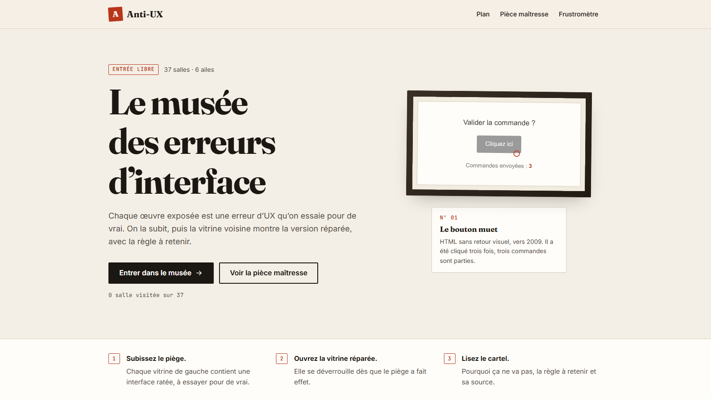

# Anti-UX · Le musée des erreurs d'interface

> Jour 23 du défi **30 jours, 30 projets** · JavaScript · CSS · ⏳ **À venir**

Un site qui apprend l'UX par l'absurde. **Anti-UX** expose, salle par salle, tout ce qu'il ne faut pas faire sur un site web : des boutons qui ne répondent pas, des boutons mal hiérarchisés, des champs de texte qui effacent votre saisie, des formulaires qui cachent leurs règles, des bannières de cookies impossibles à refuser. Chaque erreur est exposée dans une **salle** qu'on essaie pour de vrai, puis qu'on **répare** d'un geste pour voir la bonne version, avec l'explication et la règle à retenir.

Le musée lui-même, lui, doit être irréprochable : clavier, contrastes, mobile, focus visible.

📄 Les règles détaillées sont dans le [cahier des charges](CAHIER_DES_CHARGES.md).



## Au programme

- **37 salles** rangées en six ailes : gestes et boutons, saisie et formulaires, navigation et repères, retours et états, lisibilité et attention, confiance et pièges.
- Dans chaque salle, deux vitrines : **le piège**, une interface ratée qu’on essaie pour de vrai, et **la version réparée**, qui s’ouvre dès que le piège a fait effet (ou avec « Ouvrir quand même »).
- Un **cartel** par salle : pourquoi ça ne va pas, la règle à retenir et sa référence (Nielsen, WCAG 2.2, CNIL, lois de l’UX…), plus le code avant / après.
- La **pièce maîtresse**, *Coiffeur Antique* : la page de contact d’un salon, en version ratée (dix erreurs, numérotées sur demande) et en version réparée.
- Le **Frustromètre** compte les clics rageurs ; les salles visitées sont marquées sur le plan (stockage local).
- Tous les pièges sont simulés et confinés à leur vitrine : rien n’est envoyé, rien ne sort de la page.

## Le look

Direction « vrai musée » : murs blanc cassé, titres en Fraunces, texte en Inter, numéros d’inventaire en JetBrains Mono, un seul accent vermillon. Les vitrines, elles, imitent un site web quelconque (bleu, sans empattement) pour qu’on ne confonde jamais le musée et le piège.

## Organisation

- `scripts/build/build.mjs` : le plan du musée (ailes, ordre, résumé de chaque salle) et le générateur. Il produit `index.html`, `salles/<salle>.html`, `sitemap.xml` et `tests/specimens.json`. **Ne pas modifier ces fichiers à la main.**
- `scripts/build/salles.mjs` et `scripts/build/cas.mjs` : le contenu des 37 salles (textes, HTML des deux vitrines, code, gestes de test).
- `scripts/demos.js` : le comportement interactif de chaque vitrine ; `scripts/specimen.js` : verrou de la vitrine réparée et progression ; `scripts/main.js` : Frustromètre et salles visitées.
- `coiffeur/` : la pièce maîtresse (`sans-ux.html`, `avec-ux.html`, `coiffeur.js`, `styles.css`).
- Ajouter une salle : une entrée dans `salles.mjs` ou `cas.mjs`, une ligne dans le plan de `build.mjs`, sa démo dans `demos.js`, puis `npm run build`.

## Lancer en local

```bash
npm run dev       # sert le site sur http://localhost:3023
npm run build     # régénère l’accueil, les salles et le sitemap
npm test          # régénère puis lance les tests Playwright (83 tests, sur ordinateur et sur mobile)
npm run build-og  # régénère l’image Open Graph (og-image.png)
```

## Mise en ligne

Prévue sur Coolify : **https://anti-ux.projectp.fr**. Site statique, aucun serveur.

## Stack

JavaScript (modules ES) · CSS, sans framework · Playwright pour les tests.

## Avant de déclarer le projet terminé

> Rappel pour Claude : à faire sur chaque projet, sans que je le redemande (détail dans les sections 9 et 10 du cahier des charges).

- **Indexation** : `robots.txt`, `sitemap.xml`, balise canonical, données structurées JSON-LD (`WebApplication` rattachée à ProjectP) et lien « 30 jours, 30 projets » vers https://projectp.fr/ dans le pied de page. Vérifier en ligne, puis me rappeler de soumettre `https://anti-ux.projectp.fr/sitemap.xml` dans Google Search Console.
- **Aperçu du lien** : image Open Graph stylisée 1200 × 630 aux couleurs du projet et balises `og:*` / `twitter:card`, vérifiées en ligne.
- **Vitrine** : la mise à jour de `30days30projects` (README et `projects.js`) se fait **après ma validation**.